# 项目演示（完整画廊）

> 主页只展示代表作，本页保留可播放的原有媒体。点击 GIF 可播放对应完整视频。返回 [主页](./README.md) · 查看 [原生演示页](https://guoyue0412.github.io/reading-journal-sites/gallery.html) · 查看 [WAM 原生页面](https://guoyue0412.github.io/reading-journal-sites/wam.html)。

---

## 北京人形 · Weave 0.5 预训练数据基建

以下展示 Sim–Real 成对数据生产链路，**不是 Weave 0.5 模型生成结果**。当前已打通运动与时间轴对应；场景、物体和接触事件的精准复现仍在建设。

天轶 2.0 + Robotiq 与松灵双臂两平台完成 8 个 case 运动复现，REAL | SIM 视频对时长误差达 0.01s 级。

  <a href="./assets/evidence/humanoid-sim2real/tianyi_hangclothes_REAL_SIM.mp4">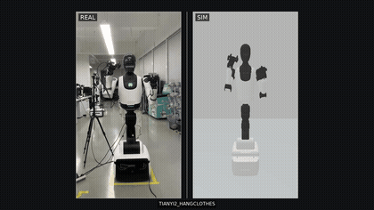</a>
  <a href="./assets/evidence/humanoid-sim2real/tianyi_right_REAL_SIM.mp4">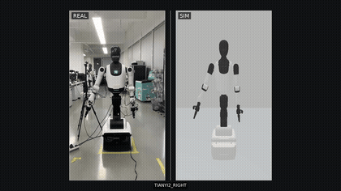</a>

*天轶 2.0 + Robotiq：REAL | SIM 帧级对齐视频对（挂衣服 / 右臂动作）*

  <a href="./assets/evidence/humanoid-sim2real/blue_REAL_SIM.mp4">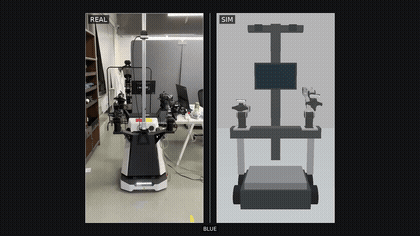</a>
  <a href="./assets/evidence/humanoid-sim2real/purple_REAL_SIM.mp4">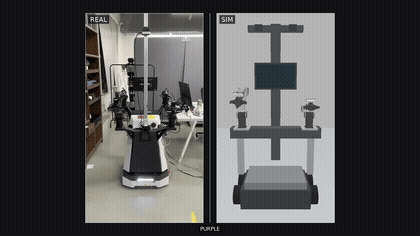</a>
  <a href="./assets/evidence/humanoid-sim2real/tray_REAL_SIM.mp4">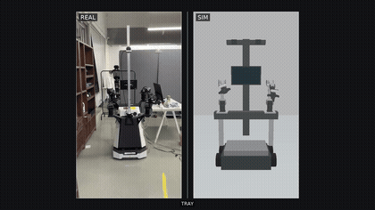</a>

*松灵双臂：REAL | SIM 视频对（BLUE / PURPLE / TRAY 三个 case）*

---

## BAAI · WAM 多视角视频预测

多视角视频 latent 联合预测，注入 FPS 条件与 3D RoPE。以下为 GT 与模型预测逐对对比；动作策略的教师—学生架构、固定 `t₀` 的 EE pose delta 和梯度边界见 [WAM 原生页面](https://guoyue0412.github.io/reading-journal-sites/wam.html)。

  <a href="./assets/evidence/baai-wam/agibot_mobile_gt_2x2.mp4">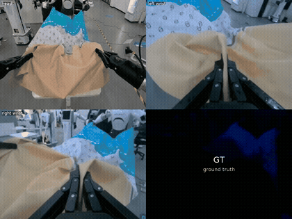</a>
  <a href="./assets/evidence/baai-wam/agibot_mobile_pred_2x2.mp4">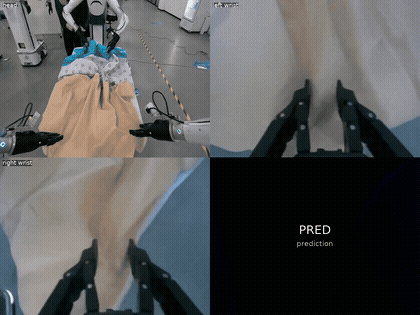</a>

*AgiBot 移动双臂：GT（左）vs WAM 预测（右）*

  <a href="./assets/evidence/baai-wam/robotwin_aloha_gt_2x2.mp4">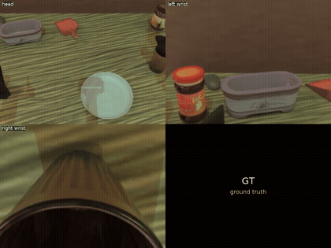</a>
  <a href="./assets/evidence/baai-wam/robotwin_aloha_pred_2x2.mp4">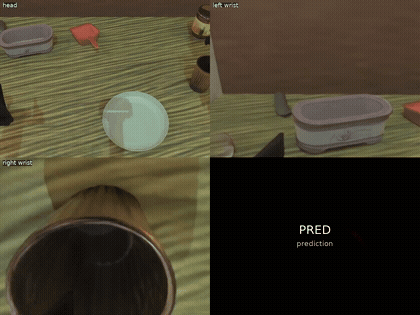</a>

*RoboTwin aloha-agilex：GT（左）vs WAM 预测（右）*

三视角对照图的上排为 AgiBot、下排为 RoboTwin，左列为 Ground truth、右列为 Prediction；每个拼接画面包含三路相机。图中的黑色格只承载 GT / Pred 标签，不计为相机视角。完整架构、EE pose delta 与三视角图见 [WAM 原生页面](https://guoyue0412.github.io/reading-journal-sites/wam.html)。

WAM 在 Franka 平台完成 100 次 rollout，成功率约 80%；该数值来自独立任务评测，不是上述视频对照的直接统计。

---

## BAAI · OpenArms 双臂叠衣（DiT4DiT 复现验证）

DiT4DiT 的主要垂域应用是酒店场景中的证件交互；下面的 OpenArms 双臂叠衣属于跨本体复现验证。

<a href="./assets/evidence/baai-dit4dit/openarm_demo.mp4">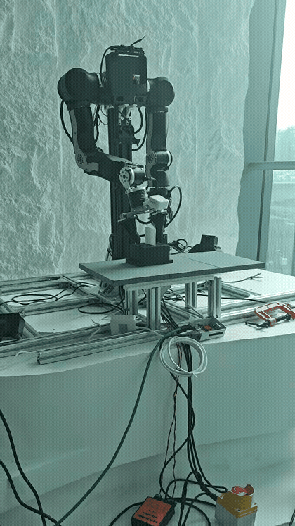</a>

*OpenArms 双臂叠衣复现 demo（跨本体动作迁移验证）*

---

## 道通 · VLA 真机操作（智元 G1 + OpenPI π₀.₅）

负责 OpenPI π₀.₅ SFT 与 ROS2 真机部署；将真机纠偏与恢复数据回流用于纠偏 SFT，工厂抓取放置任务的真机成功率由 40% 提升至 70%。

<a href="./assets/evidence/daotong-vla/vla_realrobot_test.mp4">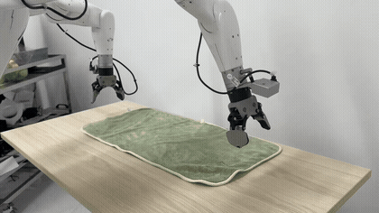</a>

*真机 VLA 测试（纠偏 SFT 后的抓取放置任务）*

<a href="./assets/evidence/daotong-vla/vr_teleop_1.mp4">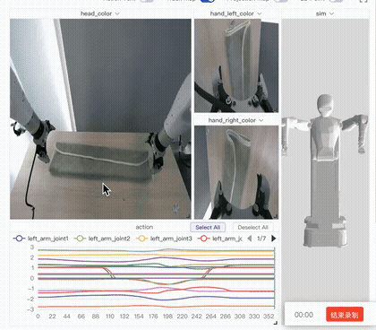</a>

*VR 遥操作数据采集*

  <a href="./assets/evidence/daotong-vla/libero10_task00.mp4">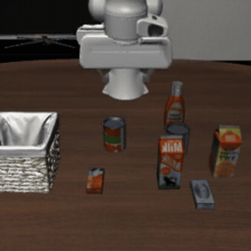</a>
  <a href="./assets/evidence/daotong-vla/libero10_task02.mp4">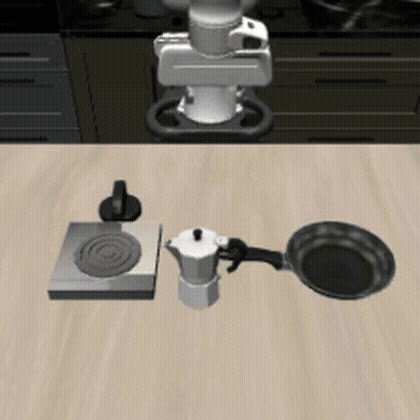</a>
  <a href="./assets/evidence/daotong-vla/libero10_task06.mp4">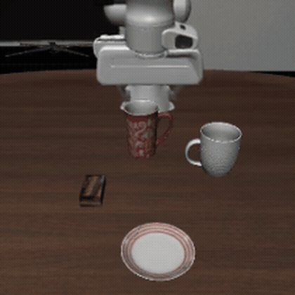</a>

*LIBERO-10 仿真评测示例（平均成功率 96.6%）*

---

## 道通 · BPTT 可微仿真与 Sim-to-Real

构建 JAX BPTT 可微仿真与残差动力学管线；训练吞吐达到原来的 10 倍，动力学预测误差降至原来的十分之一。

<a href="./assets/evidence/daotong-bptt/变形飞车迁移.mp4">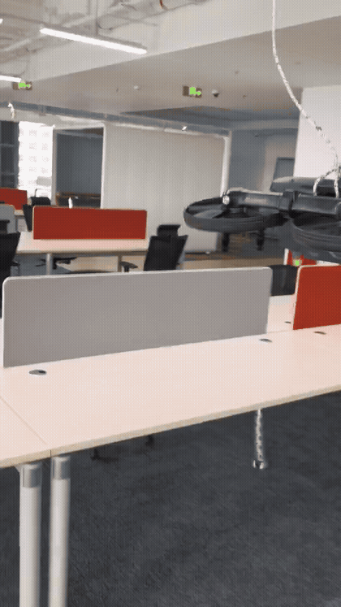</a>

*变形飞车迁移效果*

<a href="./assets/evidence/daotong-bptt/极限.mp4">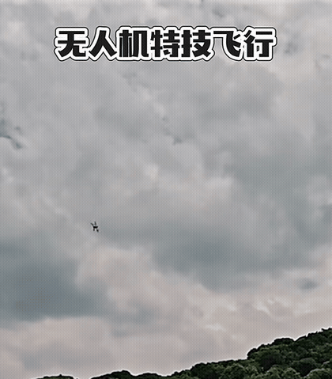</a>

*极限工况测试*

<a href="./assets/evidence/daotong-bptt/炸机.mp4">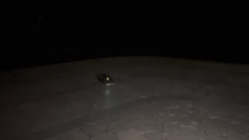</a>

*失败案例分析（炸机）*

---

## 人形机器人

<a href="./assets/evidence/humanoid/third_view.mp4">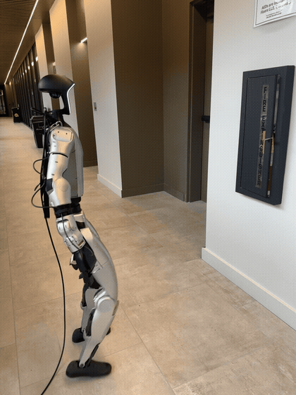</a>

*人形机器人第三视角*
